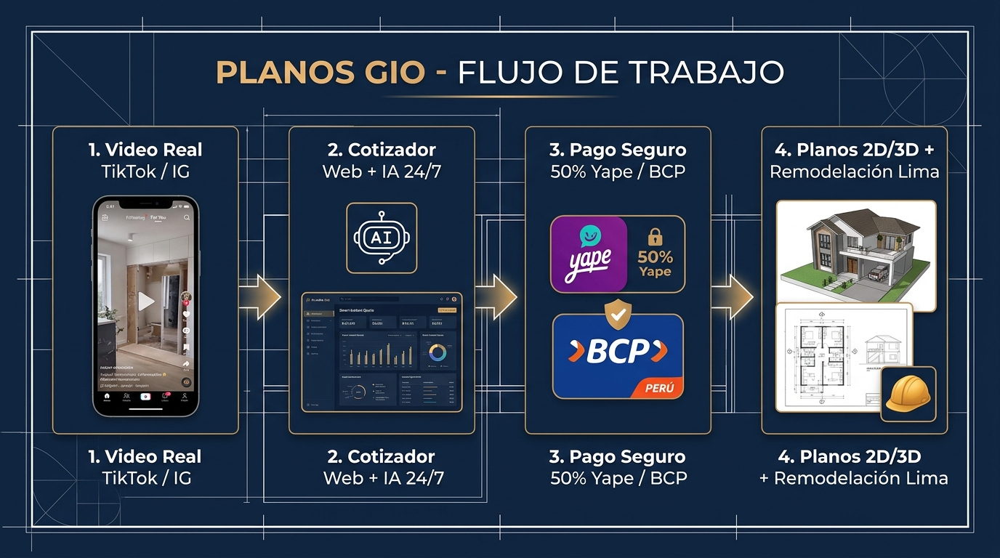
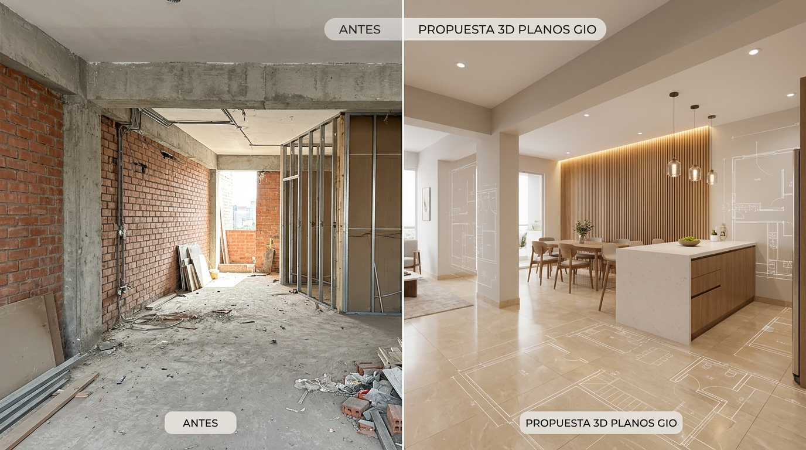
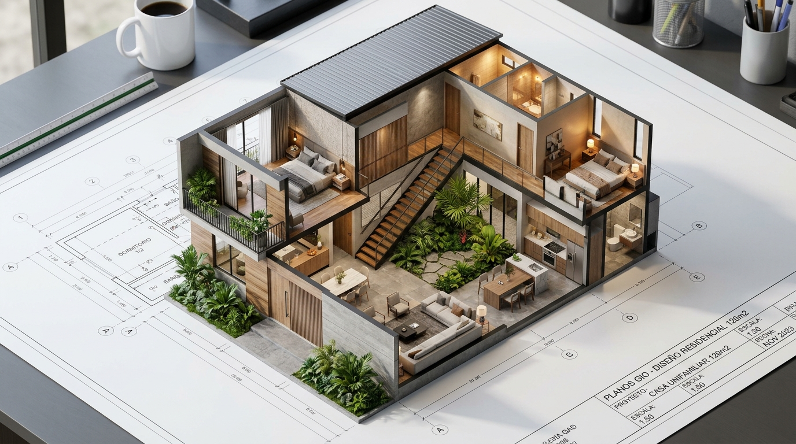
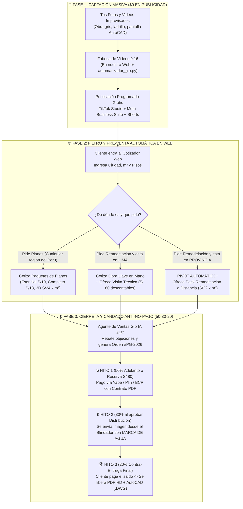

# 🏗️ Manual Maestro Ilustrado & Sistema Automatizado: **Planos Gio** (`GIO, GRUPO INGENIEROS S.A.C.`)
**RUC: 20610282963 • Partida Registral SUNARP N° 15146750 • Emisor Electrónico SUNAT (Factura y Boleta)**  
**Domicilio Fiscal:** Av. Arequipa Nro. 1421 Dpto. 1306, Urb. Santa Beatriz, Lima | **Yape / WhatsApp Oficial:** `993 952 844`  
*Diseño de Planos en Todo el Perú (100% Online) & Remodelaciones en Lima Metropolitana ($0 Costo Operativo)*

---

## 🖼️ 1. Galería Visual del Modelo de Negocio y Entregables

Desliza el carrusel para explorar las **3 piezas visuales clave** que resumen cómo funciona tu negocio, cómo se presenta una remodelación (*Antes vs. Propuesta 3D*) y cómo entregamos el paquete diferenciador (*Plano 2D + Corte Isométrico 3D + Metrado*):

````carousel

<!-- slide -->

<!-- slide -->

````

---

## 🎯 2. El Diferenciador que Hace que te Contraten a Ti (y no a la competencia)

En Perú, cuando alguien busca hacer planos o remodelar, se topa con dos extremos:
* **El informal** que cobra barato, no firma contrato, entrega tarde o deja columnas mal ubicadas que hacen gastar **S/ 8,000 a S/ 15,000 de más en ladrillo, cemento y fierro**.
* **El estudio tradicional** que demora 4 días en enviar una cotización y cobra tarifas inalcanzables.

### 💡 Tu Propuesta Única ("Método Planos Gio Anti-Sorpresas"):
1. **Cotización Instantánea en 10 Segundos + Pre-Metrado Gratis en la Web:** El cliente mueve el control de $\text{m}^2$ en [index.html](file:///d:/Documents/GitHub/Planos_Gio/index.html) y ve al instante cuánto invertirá y cuántas bolsas de cemento, ladrillos y varillas de fierro aproximadamente necesitará su obra.
2. **Planos en 2D + Vistas 3D Fáciles de Entender:** El cliente no necesita saber leer planos de AutoCAD; ve su casa en 3D antes de colocar el primer ladrillo.
3. **Cero Trabajo Gratis con el Candado 50% - 30% - 20% y Visor con Marca de Agua:** Todo se respalda con una **Orden de Servicio Digital en PDF** y vistas protegidas hasta la cancelación total.

---

## 🔄 3. Diagrama Maestro de Automatización Comercial y Cobro Seguro



---

## 🧪 4. Cuatro Ejemplos Reales Paso a Paso (Cómo Opera el Negocio en la Práctica)

### 📌 Ejemplo Real 1: Cliente en Provincia (Arequipa) que solicita Diseño de Planos
* **Cómo llega:** Ve tu TikTok *"El error de S/ 10,000 en terrenos de 120m²"* grabado desde la pantalla de tu PC.
* **Qué hace en la web:** Entra al **Cotizador Instantáneo**, selecciona **Arequipa**, elige **🥇 Paquete Construcción Segura (Todas las Especialidades)**, marca **120 m²** y **2 pisos**.
* **Cálculo automático del sistema:**
  * Tarifa base: $\text{S/ } 18/\text{m}^2$ en el primer piso + $65\%$ en el segundo piso = **S/ 3,564** (o **S/ 2,808** según promoción activa).
  * **Pre-Metrado Anti-Engaño mostrado en pantalla:** ~912 bolsas de cemento, ~9.1 millares de ladrillo KK, ~576 varillas de fierro.
* **Cómo cobra la IA sin riesgo:**
  1. Emite la **Orden de Servicio #PG-2026-1041** en PDF.
  2. El cliente abona el **50% (S/ 1,404)** por Yape/BCP para iniciar.
  3. A los 3 días le envías la distribución pasada por el **Blindador con Marca de Agua**. El cliente la aprueba y abona el **30% (S/ 842)**.
  4. Al terminar estructuras, eléctricas y sanitarias, le muestras la vista protegida. El cliente abona el **20% final (S/ 562)** y descargas sus planos HD y `.DWG`.

### 📌 Ejemplo Real 2: Cliente en Lima (Surco) que solicita Remodelación de Cocina y Sala
* **Cómo llega:** Ve tu Reel en Instagram con una foto de obra bruta convertida en cocina moderna.
* **Qué hace el Agente IA:** Detecta que está en **Lima Metropolitana** y que quiere remodelar **$28\text{ m}^2$**.
* **Candado Comercial aplicado:**
  * En vez de ir gratis a gastar gasolina y tiempo para que luego no te contrate, el Agente IA le dice: *"Agendamos hoy mismo nuestra **Visita Técnica de Levantamiento + Presupuesto Cerrado en Surco por S/ 80** vía Yape, monto 100% descontable al iniciar tu obra"*.
  * Una vez en el lugar, cierra el contrato de obra con **50% de adelanto para materiales e inicio**.

### 📌 Ejemplo Real 3: Cliente en Provincia (Trujillo) que pide Remodelación Física (*El Pivot Ganador*)
* **El problema tradicional:** Normalmente le dirías *"No vamos a Trujillo"* y perderías la venta.
* **Lo que hace tu sistema automático:** Cuando el cliente selecciona **La Libertad (Trujillo)** y pide **Remodelación**, el sistema activa automáticamente el **📦 Pack Remodelación a Distancia ($\text{S/ } 22/\text{m}^2$)**:
  * Le vendes los **Planos de Demolición y Nueva Distribución + Vistas 3D del Antes/Después + Lista Exacta de Materiales y Acabados** para que su maestro trujillano lo construya sin engañarlo. ¡Conviertes un "no" en una venta 100% digital de alto margen!

### 📌 Ejemplo Real 4: El Cliente Desconfiado que pide *"Un dibujito gratis primero y te pago al final"*
* **Qué responde automáticamente Gio IA:**
  > *"Entiendo tu precaución. Por política de ingeniería, nunca entregamos croquis improvisados sin cálculo porque ponen en riesgo tu dinero en obra. Para tu total seguridad, tienes dos caminos formales: (1) Emitimos tu Orden de Servicio legal e inicias con el 50%, o (2) Si quieres probar nuestra metodología hoy mismo sin arriesgar, separa tu **Sesión de Diagnóstico + Esquema Preliminar con solo S/ 80 por Yape**, que se descuentan al 100% del valor de tu plano."*

---

## 💻 5. Programas Desarrollados y Listos en tu Proyecto `Planos_Gio`

Todo el código ha sido programado y puesto en marcha automáticamente dentro de tu carpeta `d:\Documents\GitHub\Planos_Gio`:

| Archivo / Programa | Función Automatizada |
| :--- | :--- |
| **[index.html](file:///d:/Documents/GitHub/Planos_Gio/index.html)** | **Plataforma Todo-en-Uno (5 módulos):** Web Pública + Portafolio + Cotizador Instantáneo con Pre-Metrado + Chat Vendedor IA 24/7 + Estudio Grabador de TikToks 9:16 + Panel CEO (CRM, Blindador con Marca de Agua y Contratos PDF). |
| **[js/data.js](file:///d:/Documents/GitHub/Planos_Gio/js/data.js)** | Base de datos de reglas de negocio, precios por $\text{m}^2$, los 24 departamentos del Perú, plantillas de guiones virales para fotos/videos improvisados y calendario de 30 días. |
| **[js/app.js](file:///d:/Documents/GitHub/Planos_Gio/js/app.js)** | Motor de cálculo de presupuestos y materiales, cerebro del Agente IA (local + conector Gemini API gratis), renderizador de videos verticales `.webm` en Canvas y motor de marca de agua anti-robo. |
| **[automatizador_gio.py](file:///d:/Documents/GitHub/Planos_Gio/automatizador_gio.py)** | Programa en Python que escanea tus fotos/videos en `mis_fotos_y_videos/`, genera campañas automáticas, calcula cotizaciones y mantiene activo el servidor web local en `http://localhost:8080`. |
| **[PLAN_PUBLICACION_LISTO.md](file:///d:/Documents/GitHub/Planos_Gio/data/PLAN_PUBLICACION_LISTO.md)** | Plan de contenidos y simulaciones generado automáticamente por el script a partir de las imágenes del proyecto. |
| **[reporte_ejecutivo_gio.json](file:///d:/Documents/GitHub/Planos_Gio/data/reporte_ejecutivo_gio.json)** | Reporte estructurado en JSON con el estado del negocio, tarifas activas, guiones y simulaciones financieras. |
